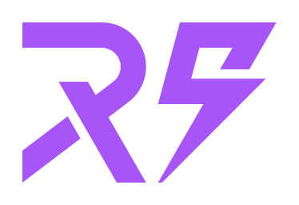

# Rohit Sondigala

**Full Stack Developer · Laravel · Node.js · React**

4.5+ years building SaaS platforms, APIs and real-time systems for international clients.

📍 Ahmedabad, India

---

### About

- Software Developer at **Logicrays Technologies** (Jan 2025 – present); previously WebMob Technologies and Sumay Infotech.
- I design REST and GraphQL APIs, role-based access control, multi-tenant architectures and optimized database schemas.
- Currently working on AI integrations (OpenAI, Gemini, Anthropic) and AWS deployments.

### Tech stack

**Backend**

**Frontend**

**Data**

**Cloud & tooling**

Also: CodeIgniter, Livewire, FilamentPHP, Stripe, Razorpay, PayPal, Twilio, WebSockets, CI/CD.

### Domains I've worked in

| Domain | What I built |
| --- | --- |
| 🏥 **Healthcare** | Appointment and consultation APIs, admin dashboards, real-time audio/video calling |
| 🧑‍💼 **Recruitment (ATS)** | Resume builder, candidate management and recruitment workflows with RBAC |
| 📊 **Project management** | Multi-tenant B2B SaaS with time tracking, activity monitoring and tenant isolation |
| 🛒 **E-commerce** | Admin panels, GraphQL/REST APIs, payment integrations, inventory management |
| 💬 **Communication** | WhatsApp broadcast and campaign platform, live chat, notifications, audio/video calls |
| 📅 **Booking** | Booking platforms and scheduling workflows |
| 🎓 **EdTech, IoT & government** | Learning systems, IoT dashboards, government portals, legacy modernization |

---

Open to interesting backend and full stack work. See my [portfolio](https://rohitsondigala.netlify.app/) or reach me on [LinkedIn](https://www.linkedin.com/in/rohit-sondigala/).

